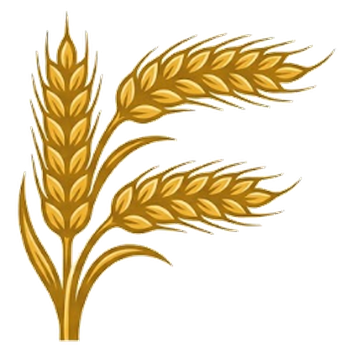

# Farm Client

**Minecraft launcher + Fabric QoL mod, built as one product.**
**Лаунчер Minecraft и QoL-мод на Fabric — единым продуктом.**

[**Сайт / Website**](https://r2d27829.github.io/Farm-Client/) · [**Купить / Buy**](https://r2d27829.github.io/Farm-Client/buy.html) · [**Скачать / Download**](https://github.com/R2D27829/Farm-Client/releases/latest) · [Changelog](CHANGELOG.md)

[Русский](#-русский) · [English](#-english)

---

## 🇷🇺 Русский

### О проекте
Farm Client — лаунчер Minecraft и клиентский Fabric-мод, которые работают в связке. Лаунчер ставит Minecraft, загрузчик, Java и моды; мод получает от лаунчера аккаунт, Discord, друзей и настройки и отдаёт обратно события из игры.

Текущие версии: **лаунчер 1.24.5**, **мод 1.36.2** · идёт **альфа-тест**.

### Обновление 1.24.5 / мод 1.36.2
- Убраны белые точки фона и белые уголки полос прокрутки; подсветка рамок за курсором сохранена.
- Обновлены главное меню игры и основная панель мода: единые контурные иконки, ровные отступы, спокойные карточки и аккуратная типографика.
- Для Inter добавлено настоящее полужирное начертание вместо искусственного утолщения. Длинные названия корректно сокращаются.
- Улучшены раскрытие настроек, обозначение включённых модулей, пустой поиск и адаптация к небольшому окну.
- Настройки, бинды, альтернативные темы, функции модулей и защита запуска сохранены. Android 1.5 не менялся.

### Обновление 1.24.2
- Фон с точками и мягким свечением, как на сайте, во всех разделах стандартной темы.
- Золотая подсветка обводки и поверхности плиток следует за курсором, включая новые плитки и окна.
- Клики, масштаб и скругление работают; другие темы и выбранный фон не сбрасываются. В режиме оптимизации подсветка отключена.
- Мод 1.36.0 и Android 1.5 не изменялись.

### Обновление 1.24.0
- Лаунчер и внутриигровой GUI используют стиль сайта: Inter, тёмные карточки, тонкие золотые линии, градиентные кнопки и более свободная компоновка.
- Auto Obsidian (1.21.11) и Obsidian Miner (по бинду) получили режим «Обычная кирка»: алмазная/незеритовая кирка, добыча по одному блоку с обычной скоростью. Камень в левой руке и эффект 3×3 не нужны. Старые серверные режимы сохранены отдельно.
- Добыча учитывает видимость и досягаемость блоков, запас прочности и свободное место, не ломает опору под игроком. Автоматически при загрузке профиля не запускается.

### Обновление 1.23.0
- Общий стиль Farm Gold для сайта, лаунчера, мода и Android-приложения 1.5.
- Пароль от 8 символов; каждую соцсеть можно скрыть отдельно в публичном профиле без потери входа.
- Рабочие кнопки сайта и сообщения об ошибке в моде; настройки Farm открывают его UI, настройки Minecraft сохранены отдельно.
- На Minecraft 1.21.11 встроены Auto Obsidian, Crying Obsidian Craft и защита от лавы. Старые клавиши R/K/Right Shift отключены; функции управляются через Utils в Farm UI. Удали отдельный AutoObsidian JAR, если он установлен. На других версиях Minecraft эти функции пока недоступны. Для автокрафта нужен серверный рецепт; используй автоматизацию только там, где разрешено.

### Возможности

- **Почта и пароль**: регистрация без ПК; существующий Farm ID можно дополнить почтовым входом в кабинете. Подтверждение адреса и автоматическое восстановление пока не подключены.

- **Регистрация без ПК**: Discord, Telegram и VK на сайте создают Farm ID без лаунчера и HWID. Лицензия на игру активируется отдельно; повторный вход возвращает тот же профиль.

**Новое в 1.22.0**
- AppleSkin в стандартных Fabric-сборках: насыщение и подсказки еды; Bobby сохранён.
- Календарь клана с записью на события и напоминаниями в Android.
- Приватная поддержка со скриншотами и ответами администраторов.
- Опросы игроков, страницы сборок с обложками и списком модов, управление активными входами.
- Android 1.4: проверка обновлений APK, опросы/поддержка, уведомления админ-чата.

**Из 1.21.2**
- Единая OAuth-привязка Discord к Farm ID на сайте и в лаунчере, включая офлайн-профили Minecraft.
- Голосовые сообщения в веб-мессенджере, закрытый чат администраторов в админ-панели.

**Из 1.21.1**
- **Bobby** — кэширование посещённых чанков для дальней прорисовки; автоматически добавляется в новые и существующие сборки. Совместимый релиз выбирается для версии Minecraft.
- **Публикации** — выбор личного или официального тега для администратора.
- **Сайт** — тарифы берутся из ручных настроек магазина, без фиксированных цен в главной странице.

**Новое в 1.21.0**
- **Кланы** — роли, трофеи, чат клана, вход на сервер клана; в лаунчере и на сайте.
- **Профили игроков и статусы** — публичная страница игрока, «не беспокоить / отошёл / невидимка».
- **Быстрый старт** — «Продолжить» последний сервер/мир, мастер первого запуска, профили «Слабый / Средний / Мощный ПК», проверка конфликтов модов, горячие клавиши.
- **Скриншоты** из всех версий в одном окне + отправка другу прямо из игры.
- **Мессенджер** — голосовые сообщения и приглашения в мир.
- **Косметика** — китайскую шляпу видят другие игроки Farm Client.
- **Лицензия** — пробный период, рефералы, промокоды; мод работает только через лаунчер Farm Client.
- **Android 1.3** — уведомления, кланы, запуск игры на ПК с телефона.

**Новое в 1.20.0**
- **Лицензии** — ключ или код активации `FARM-XXXX-XXXX-XXXX`, привязка к ПК, срок с момента активации. Без ключа мод отключает модули, меню и HUD.
- **Linux** — сборка AppImage с автообновлением.
- **Медиа в мессенджере** — фото, GIF и видео до 15 МБ (📎, перетаскивание, Ctrl+V).
- **Шрифты** встроены в лаунчер (Inter, Montserrat, Rubik, Nunito, Comfortaa, JetBrains Mono) + свой `.ttf/.otf/.woff`, в том числе в игре.
- **Облачные конфиги** и **Farm ID** — кабинет на сайте со входом по коду из лаунчера, привязка Discord / Telegram / VK, галерея тем, конфигов и сборок, мессенджер в браузере.

**Лаунчер**
- **Версии и загрузчики** — Vanilla (включая снапшоты), Fabric, Quilt, Forge, NeoForge. Готовые профили Fabric 1.16.5 / 1.21.4 / 1.21.11 / 26.3 с Farm Client и оптимизацией (Sodium, Lithium, FerriteCore, ModernFix, ImmediatelyFast, Krypton и др.).
- **Java** скачивается автоматически (официальные сборки Mojang, 17 / 21 / 25).
- **Аккаунты** — Microsoft, Ely.by (с 2FA) и офлайн; свой скин для Microsoft.
- **Каталоги Modrinth и CurseForge** — моды, ресурспаки, шейдеры, модпаки (`.mrpack` и CurseForge). Проверка обновлений и «Обновить всё».
- **Обмен сборками** — код `FARMPACK:` или файл `.farmpack` (манифест + конфиги, `options.txt`, локальные jar). Импорт «От друга».
- **Управление сборкой** в стиле Prism Launcher: память, JVM-аргументы, разрешение, версия загрузчика.
- **Главная** — новости, избранные серверы с пингом (SLP + SRV) и кнопкой «Зайти», статистика игры по дням и серверам.
- **Друзья** — мессенджер: пиши по @нику Discord или Minecraft через интернет (шифрование, доставка офлайн до 12 ч), общий чат и личка по локалке; сеть: друзья по Radmin VPN / ZeroTier / Hamachi / LAN: видно, кто в сети и какой мир открыт, «Зайти к нему», общие метки.
- **Discord** — Rich Presence (лаунчер / одиночная игра / сервер), кнопка «Присоединиться», привязка аккаунта через OAuth2, вебхук: скриншоты, краш-репорты, вход и выход с сервера.
- **Интерфейс** — темы (включая «Яблочный» Liquid Glass и «Минимализм»), свой CSS, масштаб, шрифты, мини-плеер и «Сейчас играет» (Spotify / Яндекс Музыка / любой медиаплеер Windows), трей, автообновление, свой установщик.
- **Локализация** — русский и английский (лаунчер, установщик, мод).

**Мод (Fabric)**
- ClickGUI в трёх стилях, свои вкладки, редактор HUD с раскладками (слоты 1–3, `Ctrl+C/V` — код `FARMHUD:`, выравнивание `L/R`).
- **Профили серверов** — набор модулей и биндов запоминается для каждого сервера.
- Метки (Waypoints) с обменом между друзьями, Mini Player, PvP Stats, Aim Trainer, TNT Timer, Хитбоксы, 4:3, Auction Helper, SMP Helper и десятки других модулей.
- Клавиша «Скрин в Discord» — снимок окна уходит в канал через лаунчер.

### Быстрый старт
1. Скачай из [Releases](https://github.com/R2D27829/Farm-Client/releases/latest):
   - **Windows** — `FarmClient-Setup-1.21.0.exe`
   - **Linux** — `FarmClient-1.21.0-x86_64.AppImage` (`chmod +x FarmClient-*.AppImage` и запусти)
2. Войди (Microsoft / Ely.by / офлайн).
3. Активируй ключ: **Настройки → Лицензия** (или окно при нажатии «Играть»). Ключ можно [купить на сайте](https://r2d27829.github.io/Farm-Client/buy.html) — на время альфа-теста 30 дней — 150 ₽, навсегда — 400 ₽.
4. Выбери версию → **Играть**. Всё остальное скачается само.

> SmartScreen может предупредить о неподписанном файле: «Подробнее» → «Выполнить в любом случае».

### Где лежат данные
- Игра: `%APPDATA%\.farmclient` (меняется в настройках), сборки — `instances\<id>`
- Настройки лаунчера: `%APPDATA%\Farm Client\settings.json`
- Linux: игра — `~/.config/.farmclient`, настройки — `~/.config/Farm Client/`

---

## 🇬🇧 English

### About
Farm Client is a Minecraft launcher and a client-side Fabric mod that work as a pair. The launcher installs Minecraft, the mod loader, Java and mods; the mod receives the account, Discord, friends and settings from the launcher and reports in-game events back.

Current versions: **launcher 1.24.2**, **mod 1.36.0** · **alpha test** in progress.

### Features

**New in 1.21.0**
- **Clans** — roles, trophies, clan chat, join the clan server; in the launcher and on the site.
- **Player profiles & statuses** — public player page, "do not disturb / away / invisible".
- **Quick start** — "Continue" last server/world, first-run wizard, Low/Mid/High PC profiles, mod conflict check, hotkeys.
- **Screenshots** from all versions in one window + send to a friend straight from the game.
- **Messenger** — voice messages and world invites.
- **Cosmetics** — other Farm Client players see your China hat.
- **License** — free trial, referrals, promo codes; the mod works only through the Farm Client launcher.
- **Android 1.3** — notifications, clans, launch the game on your PC from your phone.

**New in 1.20.0**
- **Licenses** — a key or an activation code `FARM-XXXX-XXXX-XXXX`, bound to your PC, term counted from activation. Without a key the mod disables its modules, menus and HUD.
- **Linux** — AppImage build with auto-updates.
- **Messenger media** — photos, GIFs and videos up to 15 MB (📎, drag & drop, Ctrl+V).
- **Fonts** bundled with the launcher (Inter, Montserrat, Rubik, Nunito, Comfortaa, JetBrains Mono) + your own `.ttf/.otf/.woff`, in-game too.
- **Cloud configs** and **Farm ID** — website account with sign-in by a launcher code, Discord / Telegram / VK linking, gallery of themes, configs and packs, in-browser messenger.

**Launcher**
- **Versions & loaders** — Vanilla (incl. snapshots), Fabric, Quilt, Forge, NeoForge. Ready Fabric profiles for 1.16.5 / 1.21.4 / 1.21.11 / 26.3 with Farm Client and a performance stack (Sodium, Lithium, FerriteCore, ModernFix, ImmediatelyFast, Krypton, etc.).
- **Java** is downloaded automatically (official Mojang runtimes 17 / 21 / 25).
- **Accounts** — Microsoft, Ely.by (2FA supported) and offline; custom skin upload for Microsoft.
- **Modrinth & CurseForge** — mods, resource packs, shaders, modpacks (`.mrpack` and CurseForge). Update checks and one-click "Update all".
- **Pack sharing** — a `FARMPACK:` code or a `.farmpack` file (manifest + configs, `options.txt`, local jars). "From a friend" import.
- **Per-instance management** à la Prism Launcher: memory, JVM args, resolution, loader version.
- **Home** — news, favourite servers with live ping (SLP + SRV) and "Join", playtime stats by day and server.
- **Friends** — messenger: message by Discord or Minecraft @nick over the internet (encrypted, offline delivery up to 12 h), LAN group chat and DMs; network: friends over Radmin VPN / ZeroTier / Hamachi / LAN: who is online, open worlds, "Join them", shared waypoints.
- **Discord** — Rich Presence (launcher / singleplayer / server), "Join" button, OAuth2 account linking, webhook for screenshots, crash reports, server join/leave.
- **UI** — themes (incl. "Apple" Liquid Glass and "Minimal"), custom CSS, scaling, fonts, mini player and Now Playing (Spotify / Yandex Music / any Windows media session), tray, auto-updates, custom installer.
- **Localization** — Russian and English (launcher, installer, mod).

**Mod (Fabric)**
- ClickGUI in three styles, custom tabs, HUD editor with layouts (slots 1–3, `Ctrl+C/V` as a `FARMHUD:` code, `L/R` stacking).
- **Server profiles** — module and keybind sets remembered per server.
- Waypoints with friend sharing, Mini Player, PvP Stats, Aim Trainer, TNT Timer, Hitboxes, 4:3, Auction Helper, SMP Helper and dozens more modules.
- "Screenshot to Discord" key — the window capture is posted through the launcher.

### Quick start
1. Download from [Releases](https://github.com/R2D27829/Farm-Client/releases/latest):
   - **Windows** — `FarmClient-Setup-1.21.0.exe`
   - **Linux** — `FarmClient-1.21.0-x86_64.AppImage` (`chmod +x FarmClient-*.AppImage`, then run it)
2. Sign in (Microsoft / Ely.by / offline).
3. Activate a key: **Settings → License** (or the prompt shown when you press Play). Keys are available on the [Buy page](https://r2d27829.github.io/Farm-Client/buy.html).
4. Pick a version → **Play**. Everything else is downloaded automatically.

> SmartScreen may warn about an unsigned binary: "More info" → "Run anyway".

### Data locations
- Game: `%APPDATA%\.farmclient` (configurable), instances in `instances\<id>`
- Launcher settings: `%APPDATA%\Farm Client\settings.json`
- Linux: game in `~/.config/.farmclient`, settings in `~/.config/Farm Client/`

---

Farm Client is not affiliated with Mojang Studios or Microsoft. Minecraft is a trademark of Mojang Synergies AB.

